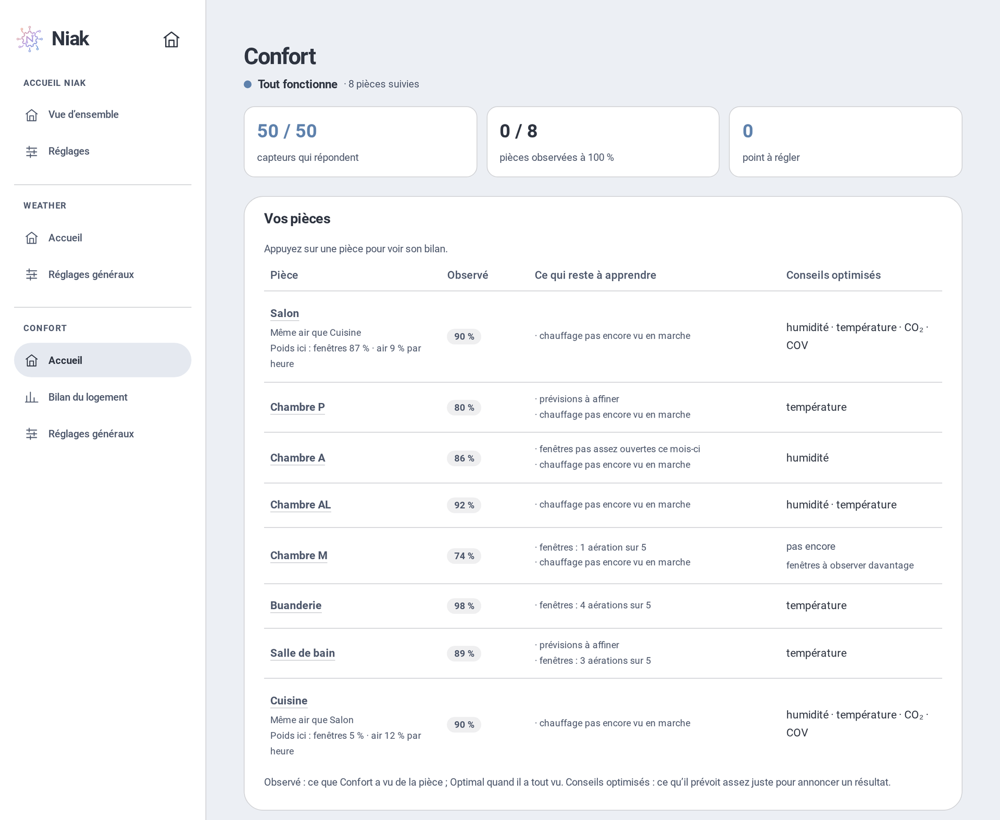

# Niak Comfort — intégration

**Le confort de chaque pièce, expliqué.** Niak Confort regarde vos pièces et le temps dehors. Il dit en une phrase quoi faire : ouvrir, fermer, attendre ou rien. Et il dit pourquoi.

Il conseille seulement : il ne commande aucun équipement.

## Pourquoi

Un thermomètre donne un chiffre. Il ne dit pas s’il faut ouvrir la fenêtre.

Niak Confort compare dedans et dehors, et répond aux questions de tous les jours :

- **Il fait chaud** : faut-il ouvrir maintenant, ce soir, ou garder fermé ? Et combien gagnerez-vous demain ?
- **Il fait frais** : faut-il vraiment rallumer le chauffage, ou est-ce juste un degré de moins ?
- **C’est humide** : aérer va-t-il vraiment assécher la pièce ? Combien de temps ?
- **L’air est lourd** : le CO₂ monte, c’est le moment d’aérer.
- **Il pleut, le vent souffle** : quelle fenêtre refermer ?

Chaque pièce apprend de ses aérations : les conseils s’ajustent à votre maison. Quand l’apprentissage est optimal, le conseil annonce le résultat : « Aérez 15 min · 76 → 68 % ».

Toute la famille lit la même carte. Elle ne parle que quand un geste aide vraiment.

## Ce qu’il faut

- Home Assistant **2026.10** ou plus récent.
- Un thermomètre dans chaque pièce à suivre. C’est le seul capteur obligatoire.
- En plus, si vous en avez : humidité, CO₂, contacts de fenêtres, thermostat (Versatile Thermostat reconnu tout seul), VMC, purificateur, volets (Adaptive Cover Pro reconnu tout seul), présence.
- Pour l’extérieur : [Niak Weather](https://github.com/Niakman13/niak-weather-integration) (conseillé) ou vos propres capteurs.

## Installation

1. Dans HACS, ⋮ → **Dépôts personnalisés** : ajoutez `https://github.com/Niakman13/niak-comfort-integration`, catégorie **Intégration**.
2. Installez **Niak Comfort**, puis redémarrez Home Assistant.
3. **Paramètres → Appareils et services → Ajouter une intégration → Niak Comfort.**
4. Ouvrez **Niak** dans la barre latérale, onglet **Confort**.

La carte est fournie par l’intégration : rien d’autre à installer.

## Premiers pas

1. **Vos pièces** : Niak reprend vos pièces Home Assistant et les capteurs qui y sont rangés. Décochez celles à ne pas suivre, puis créez-les d’un coup.
2. **L’extérieur** : dans **Réglages généraux**, choisissez Niak Weather (ses mesures sont reprises telles quelles) ou vos capteurs. Il sert à toutes les pièces.
3. **Chaque pièce** : sur l’accueil Confort, **Modifier** ouvre ses réglages. Niak propose les capteurs de la pièce : vous gardez, changez ou retirez.
4. **La carte** : sur un tableau de bord, **Ajouter une carte → Niak Confort**.

Rien n’est enregistré avant **Enregistrer**. [Le guide pas à pas](docs/guide.md).

## Les cartes

Deux cartes à choisir dans **Ajouter une carte** :

- **Niak Confort** : une pièce. Son conseil, sa température dans votre plage, ses mesures. Formats : complète, tuile, tuile dépliée, mini, mesures, alerte (visible seulement quand un geste est conseillé).
- **Niak Confort · logement** : toutes les pièces. Les conseils qui comptent, la température de chaque pièce, l’air qui traverse. Formats : complète, tuile, liste des pièces, mini, alerte.

Comme pour Niak Weather, un appui long sur une tuile (un appui sur mini et alerte) ouvre la carte complète en fenêtre, une page de votre choix, ou rien. Sur la carte logement complète ou en liste, l’appui long peut ouvrir une page, par exemple votre page Maison.

En haut, le bandeau ne porte qu’un geste, ou « Rien à faire ». Dessous, l’encart **À savoir** dit le reste en mots simples : risque de moisissure, air humide dehors, résultat de la dernière aération…

Deux pièces sans mur entre elles (un salon ouvert sur sa cuisine) partagent leur air : une seule carte « Salon · Cuisine », jamais deux gestes contraires.

La couleur dit s’il y a quelque chose à faire :

- **bleu** : tout va bien ;
- **vert** : un bénéfice à saisir (« Aérez vers 23 h ») ;
- **orange** : un geste conseillé maintenant ;
- **rouge** : urgent (la pluie entre).

Un appui sur une mesure ouvre son historique dans Home Assistant. [Lire les conseils](docs/guide.md#lire-les-conseils).

## Le panneau Niak

Tout se règle dans le panneau **Niak** de la barre latérale, onglet **Confort**. Pas de YAML, pas de nom d’entité à connaître.

- **Accueil** : l’état du logement, ce qui reste à régler, puis **Vos pièces** : les mesures de chacune, son apprentissage et un bouton **Modifier**. **Ajouter une pièce** se fait sur place. La section **Extensions** montre ce que Niak a reconnu (Niak Weather, Versatile Thermostat, Adaptive Cover Pro) et dans quelles pièces.
- **Réglages généraux** : l’extérieur, commun à toutes les pièces. Avec Niak Weather, ses mesures sont seulement affichées.
- Une pièce se règle en six onglets : Température, Ouvertures, Air intérieur, Présence, Chauffage, La pièce.

Chaque réglage a son aide. Les seuils sont expliqués avec leurs sources ([les repères](docs/SEUILS.md)).

## Avec Niak Weather et l’écosystème Niak

Niak Confort fonctionne seul. Avec [Niak Weather](https://github.com/Niakman13/niak-weather-integration), il devient plus malin :

- l’extérieur se règle en un clic : la station de votre lieu Weather ;
- il anticipe : « Refermez avant la pluie », « Ouvrez vers 22 h », rafraîchir la nuit avant une journée chaude ;
- il prévoit la nuit quand une pièce a chaud : « Cette nuit : ouvrez de 22 h à 7 h · 1,8 °C de mieux demain au plus chaud ». Il tient compte des murs, qui gardent la fraîcheur, et du soleil qui entre quand on relève les volets. Une idée inspirée de [NADIR](https://github.com/solal3105/NADIR2), de Solal Gendrin ;
- il tient compte des vigilances et des orages ;
- l’air du dehors suit la source choisie dans Weather (Atmo France ou une station WAQI). Si Atmo France tombe en panne, Confort garde l’indice du jour. Il faut Niak Weather 2.5.7 ou plus récent.

Les deux briques partagent le panneau **Niak** et la même charte. L’**Accueil Niak** montre l’état de chacune.

## Avec Versatile Thermostat

Le chauffage d’une pièce est un [Versatile Thermostat](https://github.com/jmcollin78/versatile_thermostat) ? Niak le reconnaît tout seul, dès que vous le choisissez dans l’onglet **Chauffage** :

- sa consigne sert de minimum à la pièce : en éco à 17 °C, une pièce à 18 °C n’est pas « trop fraîche ». En hors-gel, c’est sa température confort qui compte ;
- Niak sait pourquoi il est arrêté. Seul un arrêt à la main donne « Rallumez le chauffage ». Arrêté par une fenêtre ouverte ou par lui-même, il repartira seul : la carte l’explique ;
- en éco, hors-gel ou absence, une pièce plus fraîche est voulue : Niak ne demande rien ;
- la fenêtre ouverte qu’il détecte est signalée, même sans contact sur la fenêtre.

Sans Versatile Thermostat, « Rallumez le chauffage » attend que la pièce soit nettement sous son minimum (1 °C par défaut, réglable) depuis 30 minutes. Niak ne commande rien. Il faut Niak Confort 1.5.0 ou plus récent.

## Avec Alarmo et vos personnes

- [Alarmo](https://github.com/nielsfaber/alarmo) est reconnu tout seul (ou choisissez une autre alarme dans **Réglages généraux**). Armée en absence, la maison est vide et une fenêtre ouverte devient urgente ; en mode nuit, elle est signalée.
- Dans l’onglet **Présence** de chaque pièce, cochez les personnes à qui elle sert : la chambre de quelqu’un qui est parti compte comme vide.

## Avec Adaptive Cover Pro

Vos volets sont pilotés par [Adaptive Cover Pro](https://github.com/jrhubott/adaptive-cover-pro) ? Niak le reconnaît tout seul, dès que vous choisissez le volet d’une fenêtre :

- il lit ses interrupteurs (intégration, pilotage automatique, suivi du soleil, mode climat, détection de la reprise à la main) : rien à renseigner ;
- il reprend l’orientation exacte de la fenêtre, sa largeur et sa hauteur ;
- quand Adaptive Cover Pro pilote le volet, Niak ne vous demande pas de le faire ;
- s’il est coupé, Niak vous prévient, même avant que le soleil n’arrive : « à fermer avant 13 h 50 » ;
- la carte a une tuile **Volet** : position, et qui le pilote.

Niak ne commande toujours rien. Il faut Niak Confort 1.1.3 ou plus récent. Voir [le guide](docs/guide.md#avec-adaptive-cover-pro).

## Pour vos automatisations

Chaque pièce crée quelques entités :

| Entité | Ce qu’elle dit |
| --- | --- |
| **Situation** | Tout va bien, potentiel, geste conseillé, attention, information incomplète |
| **Geste** | Ouvrir, fermer, attendre, aucun nouveau geste |
| **Raison** | Pourquoi : pluie, CO₂, rafraîchissement possible, soleil qui entre… |
| **Chauffage observé** | Chauffe, au repos, arrêté |
| **Couverture des données** | Toutes les sources répondent, ou bilan partiel |

Par exemple : une notification quand le geste du salon passe à **Fermer**. [Le détail des entités](docs/guide.md#pour-vos-automatisations).

## Documentation

| Page | Ce qu’elle explique |
| --- | --- |
| [Guide d’utilisation](docs/guide.md) | Premiers pas, extérieur, pièces, lire les conseils, équipements, apprentissage, entités |
| [Dépannage](docs/depannage.md) | « Ne répond pas », carte invisible, sources, Niak Weather, volets, journaux |
| [Les repères](docs/SEUILS.md) | CO₂, particules, humidité, COV : les seuils proposés et leurs sources |
| [Notes techniques](docs/dev/README.md) | Pour les développeurs : tests, interfaces, notes de conception |

## Limites

Niak Confort conseille. Il n’ouvre, ne ferme et ne règle rien.

Une mesure absente reste inconnue : rien n’est inventé.

Les durées d’aération, l’ombre et la buée sont des estimations. Elles ne remplacent pas une mesure.

Un indice de qualité de l’air du jour ne mesure pas l’air devant vos fenêtres.

## Licence

[MIT](LICENSE) — Niakman13.
