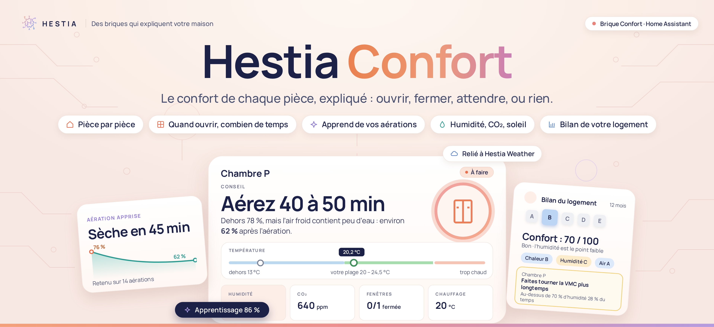

# Hestia Comfort — intégration

**Le confort de chaque pièce, expliqué.** Hestia Confort regarde vos pièces et le temps dehors. Il dit en une phrase quoi faire : ouvrir, fermer, attendre ou rien. Et il dit pourquoi.

## Pourquoi

Un thermomètre donne un chiffre. Il ne dit pas s’il faut ouvrir la fenêtre.

Hestia Confort compare dedans et dehors, et répond aux questions de tous les jours :

- **Il fait chaud** : faut-il ouvrir maintenant, ce soir, ou garder fermé ? Et combien gagnerez-vous demain ?
- **Il fait frais** : faut-il vraiment rallumer le chauffage, ou est-ce juste un degré de moins ?
- **C’est humide** : aérer va-t-il vraiment assécher la pièce ? Combien de temps ?
- **L’air est lourd** : le CO₂ monte, c’est le moment d’aérer.
- **Il pleut, le vent souffle** : quelle fenêtre refermer ?

Chaque pièce apprend de ses aérations : les conseils s’ajustent à votre maison. Quand l’apprentissage est optimal, le conseil annonce le résultat : « Aérez 15 min · 76 → 68 % ».

Toute la famille lit la même carte. Elle ne parle que quand un geste aide vraiment.

## Ce qu’il faut

- Home Assistant **2026.10** ou plus récent.
- Un thermomètre dans chaque pièce à suivre. C’est le seul capteur obligatoire.
- En plus, si vous en avez : humidité, CO₂, contacts de fenêtres, thermostat, VMC, purificateur, volets, présence. Les [extensions](#les-extensions) sont reconnues toutes seules.
- Pour l’extérieur : [Hestia Weather](https://github.com/Niakman13/niak-weather-integration) (conseillé) ou vos propres capteurs.

## Installation

1. Dans HACS, ⋮ → **Dépôts personnalisés** : ajoutez `https://github.com/Niakman13/niak-comfort-integration`, catégorie **Intégration**.
2. Installez **Hestia Comfort**, puis redémarrez Home Assistant.
3. **Paramètres → Appareils et services → Ajouter une intégration → Hestia Comfort.**
4. Ouvrez **Hestia** dans la barre latérale, onglet **Confort**.

La carte est fournie par l’intégration : rien d’autre à installer.

## Premiers pas

1. **Vos pièces** : Hestia reprend vos pièces Home Assistant et les capteurs qui y sont rangés. Décochez celles à ne pas suivre, puis créez-les d’un coup.
2. **L’extérieur** : dans **Réglages généraux**, choisissez Hestia Weather (ses mesures sont reprises telles quelles) ou vos capteurs. Il sert à toutes les pièces.
3. **Chaque pièce** : dans **Réglages généraux**, **Modifier** ouvre ses réglages. Hestia propose les capteurs de la pièce : vous gardez, changez ou retirez.
4. **La carte** : sur un tableau de bord, **Ajouter une carte → Hestia Confort**.

Rien n’est enregistré avant **Enregistrer**. [Le guide pas à pas](docs/guide.md).

## Les cartes

Trois cartes à choisir dans **Ajouter une carte** :

- **Hestia Confort** : une pièce. Son conseil, sa température dans votre plage, ses mesures. Formats : complète, tuile, tuile dépliée, mini, mesures, alerte (visible seulement quand un geste est conseillé).
- **Hestia Confort · logement** : toutes les pièces. Les conseils qui comptent, la température de chaque pièce, l’air qui traverse. Formats : complète, tuile, liste des pièces, mini, alerte.
- **Hestia Confort · bilan** : la note du logement sur douze mois. Formats : résumé (un appui ouvre le bilan complet) ou complet.

Comme pour Hestia Weather, un appui long sur une tuile (un appui sur mini et alerte) ouvre la carte complète en fenêtre, une page de votre choix, ou rien. Sur la carte logement complète ou en liste, l’appui long peut ouvrir une page, par exemple votre page Maison.

En haut, le bandeau ne porte qu’un geste, ou « Rien à faire ». Dessous, l’encart **À savoir** dit le reste en mots simples : risque de moisissure, air humide dehors, résultat de la dernière aération…

Deux pièces sans mur entre elles (un salon ouvert sur sa cuisine) partagent leur air : une seule carte « Salon · Cuisine », jamais deux gestes contraires.

La couleur dit s’il y a quelque chose à faire :

- **bleu** : tout va bien, ou « Au mieux » quand aucun geste ne peut faire mieux ;
- **vert** : un bénéfice à saisir (« Aérez vers 23 h ») ;
- **orange** : un geste conseillé maintenant ;
- **rouge** : urgent (la pluie entre).

Sous l’échelle, le graphique **« Prochaines heures »** montre la pièce sans le geste conseillé et avec : vous voyez ce qu’il change.

Hestia ne conseille d’aérer que si c’est mieux qu’attendre, et jamais en pleine nuit : il dit à partir de quelle heure.

Un appui sur une mesure ouvre son historique dans Home Assistant. [Lire les conseils](docs/guide.md#lire-les-conseils).

## Le bilan du logement

Une note de confort de **A à E**, pour le logement et pour chaque pièce, sur les douze derniers mois. Elle suit la norme européenne EN 16798-1.

- La chaleur, l’humidité et l’air, en graphiques.
- La fiche de chaque pièce : mois par mois, une journée type l’hiver et l’été.
- Des conseils seulement s’il y a un problème qui dure : chauffer une pièce restée trop froide, faire tourner la VMC, ouvrir la nuit après un été chaud.

Il est dans le panneau **Hestia**, onglet **Confort**, sous **Accueil**. La carte **Hestia Confort · bilan** le montre à toute la famille. Il faut deux semaines de mesures pour noter un thème. [Le bilan en détail](docs/guide.md#le-bilan-du-logement).

## Le panneau Hestia

Tout se règle dans le panneau **Hestia** de la barre latérale, onglet **Confort**. Pas de YAML, pas de nom d’entité à connaître.

- **Accueil** : à lire seulement. L’état du logement, ce qui reste à régler, l’apprentissage de chaque pièce, l’état des extensions, puis **Versions et liens**. Une pièce s’ouvre sur son bilan.
- **Bilan du logement** : la note et la fiche de chaque pièce.
- **Réglages généraux** : tout ce qui se modifie. Les pièces (**Modifier**, **Ajouter une pièce**), le dehors, puis les [extensions](#les-extensions).
- Une pièce se règle en six onglets : Température, Ouvertures, Air intérieur, Présence, Chauffage, La pièce.

Chaque réglage a son aide. Les seuils sont expliqués avec leurs sources ([les repères](docs/SEUILS.md)).

## Les extensions

Hestia Confort fonctionne seul. Chaque extension installée le rend plus juste, là où elle sert. Elles se règlent toutes au même endroit : **Réglages généraux → Extensions**.

| Extension | Ce qu’elle apporte |
| --- | --- |
| [Hestia Weather](https://github.com/Niakman13/niak-weather-integration) | Le dehors pour toutes les pièces, avec les prévisions, les vigilances et l’air |
| [Versatile Thermostat](https://github.com/jmcollin78/versatile_thermostat) | La consigne et la raison d’un arrêt : plus de « Rallumez » quand le thermostat s’en charge |
| [Adaptive Cover Pro](https://github.com/jrhubott/adaptive-cover-pro) | Les volets pilotés avec le soleil : Confort sait quand ils se ferment |
| [Alarmo](https://github.com/nielsfaber/alarmo) | Maison vide, nuit, vacances : une fenêtre ouverte alarme armée est signalée |

Chacune est reconnue toute seule : rien à renseigner. Hestia Weather se choisit pour le dehors, à la place de vos propres capteurs. Les extensions tierces ont un interrupteur ; coupée, une extension n’est lue dans aucune pièce.

**Confort repère aussi les extensions qu’il pourrait lire.** Il en trouve une dans votre Home Assistant, Scheduler par exemple ? Elle apparaît sous **Détectées, pas encore lues par Confort**, avec ce qu’elle pourrait apporter. **Demander** ouvre une demande toute prête sur GitHub ; rien n’est envoyé sans vous.

### Hestia Weather

L’extension officielle, de la même famille. Avec elle, Confort :

- règle le dehors en un clic : la station de votre lieu Weather ;
- anticipe : « Refermez avant la pluie », « Ouvrez vers 22 h », rafraîchir la nuit avant une journée chaude ;
- prévoit la nuit quand une pièce a chaud : « Cette nuit : ouvrez de 22 h à 7 h · 1,8 °C de mieux demain au plus chaud ». Il tient compte des murs, qui gardent la fraîcheur, et du soleil qui entre quand on relève les volets. Une idée inspirée de [NADIR](https://github.com/solal3105/NADIR2), de Solal Gendrin ;
- tient compte des vigilances et des orages ;
- suit la source d’air choisie dans Weather (Atmo France ou une station WAQI).

Sans elle, choisissez **Vos propres capteurs** : une mesure à la fois, toutes facultatives. La liaison se règle des deux côtés et les deux disent toujours la même chose : dans Hestia Weather 2.9.0 ou plus récent, **Réglages → Extensions → Hestia Confort**. Coupée d’un côté, elle l’est des deux. Les deux briques partagent le panneau **Hestia** et la même charte.

### Versatile Thermostat

Dès que vous le choisissez dans l’onglet **Chauffage** d’une pièce :

- sa consigne sert de minimum à la pièce : en éco à 17 °C, une pièce à 18 °C n’est pas « trop fraîche » ;
- seul un arrêt à la main donne « Rallumez le chauffage ». Arrêté par une fenêtre ouverte ou par lui-même, il repartira seul : la carte l’explique ;
- en éco, hors-gel ou absence, une pièce plus fraîche est voulue : Hestia ne demande rien ;
- la fenêtre ouverte qu’il détecte est signalée, même sans contact sur la fenêtre.

Un autre thermostat ne dit pas s’il chauffe ? Choisissez son **indicateur de chauffe** (vanne, relais, état de marche) dans l’onglet **Chauffage** : l’apprentissage du chauffage peut alors aller jusqu’au bout.

### Adaptive Cover Pro

Dès que vous choisissez le volet d’une fenêtre :

- Hestia lit ses interrupteurs (pilotage automatique, suivi du soleil, mode climat, reprise à la main) et l’orientation exacte de la fenêtre ;
- quand Adaptive Cover Pro pilote le volet, Hestia ne vous demande pas de le faire ;
- s’il est coupé, Hestia prévient avant que le soleil n’arrive : « à fermer avant 13 h 50 » ;
- la carte a une tuile **Volet** : position, et qui le pilote.

[Plus de détails](docs/guide.md#avec-adaptive-cover-pro).

### Alarmo et vos personnes

- Armée en absence, la maison est vide et une fenêtre ouverte devient urgente ; en mode nuit, elle est signalée.
- Dans l’onglet **Présence** de chaque pièce, cochez les personnes à qui elle sert : la chambre de quelqu’un qui est parti compte comme vide.

Hestia ne commande aucune de ces extensions : il les lit.

## Pour vos automatisations

Les entités disent ce que dit la carte :

| Entité | Ce qu’elle dit |
| --- | --- |
| **Conseil** | Le titre de la carte : Rien à faire, Aérez 10 min, Lancez la VMC… |
| **État** | La pastille : Tout va bien, Au mieux, Geste conseillé… |
| **Couleur** | La couleur de la carte, prête pour une lumière |
| **Geste à faire**, **Aération conseillée**, **Fenêtres à refermer**, **VMC conseillée**, **Trop humide** | Oui ou non |

Des pièces au même air (« Salon · Cuisine ») ont un seul appareil pour leur conseil. « Mon logement » donne le geste le plus important et sa couleur.

Par exemple : des LED aux couleurs de la carte, ou la VMC qui suit le conseil. [Le détail des entités](docs/guide.md#pour-vos-automatisations).

## Documentation

| Page | Ce qu’elle explique |
| --- | --- |
| [Guide d’utilisation](docs/guide.md) | Premiers pas, extérieur, pièces, lire les conseils, bilan du logement, équipements, apprentissage, entités |
| [Dépannage](docs/depannage.md) | « Ne répond pas », carte invisible, sources, Hestia Weather, volets, journaux |
| [Les repères](docs/SEUILS.md) | CO₂, particules, humidité, COV : les seuils proposés et leurs sources |
| [Notes techniques](docs/dev/README.md) | Pour les développeurs : tests, interfaces, notes de conception |

## Limites

Hestia Confort conseille. Il n’ouvre, ne ferme et ne règle rien.

Une mesure absente reste inconnue : rien n’est inventé.

Les durées d’aération, l’ombre et la buée sont des estimations. Elles ne remplacent pas une mesure.

Un indice de qualité de l’air du jour ne mesure pas l’air devant vos fenêtres.

## Licence

[MIT](LICENSE) — Niakman13.
