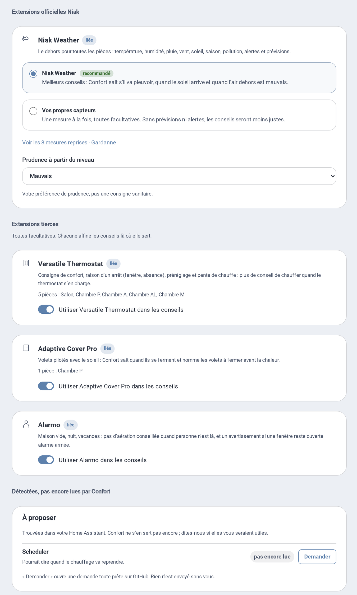
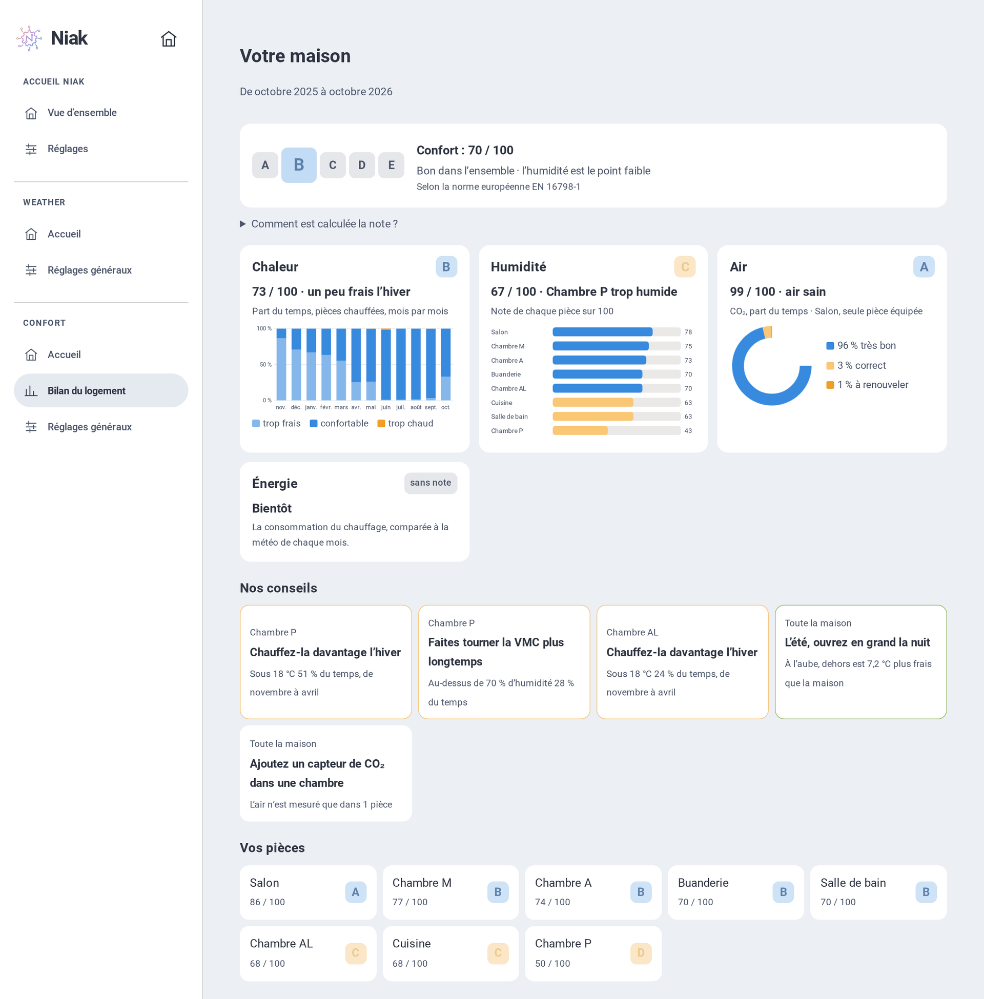

# Guide d’utilisation

Hestia Confort dit, pour chaque pièce, quoi faire et pourquoi. Ce guide explique comment le régler et comment lire ses conseils.

- [Premiers pas](#premiers-pas)
- [L’extérieur](#lextérieur)
- [Les pièces](#les-pièces)
- [Lire les conseils](#lire-les-conseils)
- [Le bilan du logement](#le-bilan-du-logement)
- [Fenêtres, chauffage, VMC, purificateur, volets](#fenêtres-chauffage-vmc-purificateur-volets)
- [Chaque pièce apprend](#chaque-pièce-apprend)
- [Pour vos automatisations](#pour-vos-automatisations)

Un souci ? Voir le [dépannage](depannage.md).

## Premiers pas

1. Installez **Hestia Comfort** depuis HACS, puis redémarrez Home Assistant ([installation](../README.md#installation)).
2. **Paramètres → Appareils et services → Ajouter une intégration → Hestia Comfort.**
3. Ouvrez **Hestia** dans la barre latérale, onglet **Confort**.
4. Hestia propose toutes les pièces où il trouve une température. Décochez celles à ne pas suivre, puis créez-les d’un coup.
5. Réglez l’extérieur une fois, dans **Réglages généraux**.
6. Ajoutez la carte à un tableau de bord : **Ajouter une carte → Hestia Confort**.

Seule la température de la pièce est obligatoire. Chaque capteur ajouté rend les conseils plus justes.

Rien n’est enregistré avant **Enregistrer**. Vous pouvez revenir à chaque onglet avant.

## L’extérieur

L’extérieur se règle une seule fois, dans **Confort → Réglages généraux**. Il sert à toutes les pièces.

### Avec Hestia Weather

Si [Hestia Weather](https://github.com/Niakman13/niak-weather-integration) est installé, choisissez **Hestia Weather** puis votre lieu.

Confort reprend alors, sans rien à choisir :

- la station de votre lieu : température, humidité, pluie, vent, soleil ;
- les prévisions : « Refermez avant la pluie », « Aérez vers 22 h », fraîcheur de la nuit ;
- les vigilances et les orages ;
- la qualité de l’air du jour.

Les mesures sont seulement affichées, avec leur valeur du moment. Pour en changer : changez la station dans Hestia Weather, ou choisissez **Vos propres capteurs**.

**La liaison se règle des deux côtés.** Dans Hestia Weather 2.9.0 ou plus récent, **Réglages → Extensions → Hestia Confort** : un interrupteur relie le lieu à Confort. Choisir **Vos propres capteurs** dans Confort la coupe aussi côté Weather. Les deux disent toujours la même chose. Coupée, Confort garde les capteurs du dehors comme les siens, sans l’air de Hestia Weather.

L’air du dehors suit la source choisie dans Hestia Weather : Atmo France ou une station WAQI. Changez-la dans Weather : Confort suit. Il faut Hestia Weather 2.5.7 ou plus récent. Dans Confort, seul le niveau de prudence se règle. Pour ne pas tenir compte de l’air, désactivez la qualité de l’air dans Hestia Weather.

### Avec vos propres capteurs

Choisissez **Vos propres capteurs**, puis le capteur de chaque mesure ; sa valeur du moment s’affiche à côté. Toutes sont facultatives :

| Mesure | À quoi elle sert |
| --- | --- |
| Température et humidité | Savoir si l’air du dehors rafraîchit ou assèche |
| Pluie (en mm/h, la pluie en cours) | Faire refermer les fenêtres exposées |
| Rafales | Ne rien laisser ouvert par vent fort |
| Direction du vent | Dire quelles fenêtres ouvrir pour faire traverser l’air |
| Ensoleillement (W/m²) | Repérer le soleil qui chauffe une façade |
| Qualité de l’air | Éviter d’aérer quand l’air du dehors est mauvais |

Pour la qualité de l’air, trois choix : **Atmo France**, l’indice de **Hestia Weather**, ou aucune.

L’indice du jour est une précaution. Il ne mesure pas l’air devant vos fenêtres.

Une mesure absente reste inconnue : Hestia conseille quand même et le dit sur la carte.

## Les pièces

Le menu de gauche de l’onglet **Confort** a trois pages :

- **Accueil** se lit seulement : vos pièces et leur apprentissage, l’état des extensions, les versions et les liens utiles. Appuyez sur une pièce pour voir son bilan.
- **Bilan du logement** : la note de confort sur douze mois ([plus bas](#le-bilan-du-logement)).
- **Réglages généraux** : tout ce qui se modifie. **Modifier** ouvre les réglages d’une pièce ; **Ajouter une pièce** propose vos pièces Home Assistant pas encore suivies, ou une pièce libre.

La rubrique **Extensions** des Réglages généraux a trois parties :

- **Extensions officielles Hestia** : Hestia Weather, ou vos propres capteurs pour le dehors ([L’extérieur](#lextérieur)).
- **Extensions tierces** : Versatile Thermostat, Adaptive Cover Pro et Alarmo. Chacune dit à quoi elle sert, dans quelles pièces, et a un interrupteur. Coupée, elle n’est lue dans aucune pièce, et les réglages des pièces le disent.
- **Détectées, pas encore lues par Confort** : les intégrations de votre Home Assistant qui pourraient aider, Scheduler par exemple. **Demander** ouvre une demande toute prête sur GitHub ; rien n’est envoyé sans vous.




### Hestia part de vos pièces Home Assistant

Vous avez déjà rangé vos appareils par pièce dans Home Assistant ? Hestia s’en sert. Presque tout est prérempli.

- **Les pièces** : Hestia propose chaque pièce Home Assistant qui a un thermomètre. Vous cochez, il les crée d’un coup.
- **Les capteurs** : pour chaque mesure, il propose ceux de la pièce. Un capteur compte s’il est rangé dans la pièce, lui ou son appareil.
- **La température et l’humidité de la pièce** : si vous les avez choisies dans Home Assistant, Hestia les prend en premier.
- **L’étage** : celui de la pièce dans Home Assistant.

Vous vérifiez, vous gardez, vous changez. Rien n’est choisi sans vous.

Plusieurs capteurs possibles ? Hestia les montre tous et vous choisissez.

Un capteur d’une autre pièce, ou d’un appareil dehors, demande une confirmation.

Un capteur mal rangé ? Corrigez sa pièce dans Home Assistant : Hestia le proposera au bon endroit. Vous pouvez aussi choisir n’importe quel capteur avec le sélecteur de Home Assistant.

Une pièce ajoutée plus tard dans Home Assistant apparaît dans **À améliorer** : « Bureau pas encore suivie ».

Hestia ne devine rien d’un nom : il suit le rangement de Home Assistant et la nature des capteurs.

### Pièce libre

Une pièce sans pièce Home Assistant : « Étage », « Suite parentale »… Vous choisissez les capteurs et, si besoin, l’étage.

Les pièces extérieures (Jardin, Terrasse…) ne sont pas proposées comme pièces.

### Six onglets par pièce

Chaque pièce a six onglets, détaillés ci-dessous. Le cadre **À quoi sert cette étape ?** explique chacun.

### Température

- La température : la seule mesure obligatoire.
- L’humidité : facultative, elle repère un air humide ou sec.
- Votre plage de confort : 20 à 24 °C l’hiver, jusqu’à 26 °C l’été par défaut.
- La plage d’été arrive en douceur, quand les 7 derniers jours se réchauffent.
- La plage d’humidité : minimum 40 % et maximum 60 % proposés, réglables pour chaque pièce. Le maximum déjà choisi est conservé.

Un écart jusqu’à 3 points reste discret : « Légèrement humide » ou « Légèrement sec », sans compter la pièce parmi celles à surveiller pour ce seul écart. Entre 3 et 10 points, la carte indique « Air humide » ou « Air sec » ; au-delà de 10 points, « Très humide » ou « Très sec ». Ce sont des paliers d’affichage Hestia, pas des seuils sanitaires. À 60,6 % avec un maximum de 60 %, la carte indique donc « Légèrement humide ».

L’état affiché suit la mesure actuelle, même après une humidité plus élevée. Une amélioration et un écart durable sont précisés dans « À savoir ». Le conseil reste lié à un geste utile : ouvrir n’est pas conseillé pour un léger dépassement seul, et un risque estimé sur les murs froids reste expliqué séparément. Pour un air sec, la carte précise si l’air extérieur assécherait davantage ou pourrait augmenter l’humidité ; sans mesure extérieure, elle ne suppose aucun effet.

### Ouvertures

Pour chaque fenêtre ou porte qui donne dehors :

- son contact (ouvert ou fermé) ;
- son exposition : N, NE, E, SE, S, SO, O, NO ;
- son type : fenêtre, porte-fenêtre, vasistas, porte ;
- s’il est abrité par une avancée de toit ou un balcon ;
- son volet : aucun, manuel ou connecté ([les volets](#volets)).

Les dimensions sont facultatives. Elles affinent l’ombre et la durée d’aération.

Pas de contact dans une pièce, et c’est voulu (un garage, une pièce jamais aérée) ? Cochez **Pas de contact de fenêtre ici, c’est voulu** : la suggestion « ouvrants non mesurés » disparaît pour cette pièce.

### Air intérieur

Tout est facultatif :

- **CO₂** : aérer ferait du bien à 800 ppm, aérer à 1 000, attention à 1 500.
- **Particules fines PM2.5** : signalement à 15 µg/m³.
- **COV** : un seuil seulement si votre capteur est reconnu (indice 150 pour une IKEA VINDSTYRKA).
- **Purificateur** et **Ventilation (VMC)**, avec sa grande vitesse si elle en a une.

Chaque seuil est expliqué avec ses sources : [les repères](SEUILS.md).

### Présence

Des détecteurs de présence ou de mouvement, facultatifs.

Une pièce vide adapte ses conseils. Son suivi continue : une fenêtre ouverte reste signalée.

Un détecteur de mouvement silencieux ne prouve pas que la pièce est vide. Délai avant de la considérer vide : 5 minutes par défaut. Pendant ce délai, la carte dit « personne depuis 3 min ».

**Personnes de la pièce** : cochez les personnes de Home Assistant à qui sert la pièce. Une pour une chambre, plusieurs pour une pièce commune. La pièce compte comme vide quand elles sont toutes absentes, même si d’autres sont à la maison : pas de « Rallumez le chauffage » dans la chambre de quelqu’un qui est parti, et un avertissement si sa fenêtre est restée ouverte. Sans case cochée, toute la maison compte.

**Alarme** : Alarmo est reconnu tout seul. Pour ne pas en tenir compte, coupez-le dans **Réglages généraux → Extensions**. Armée en absence ou en vacances, la maison est vide, et une fenêtre ouverte devient urgente : « Refermez ». En mode nuit, une fenêtre ouverte est signalée, sauf celle que vous avez dit laisser ouverte exprès pour dormir au frais.

### Chauffage

**Pièce chauffée**, en tête de l’onglet : éteint, Hestia ne conseille jamais de réchauffer la pièce et ne lit pas son chauffage. Le thermostat et ses réglages s’effacent ; ils sont gardés si vous le rallumez.

Ensuite, le thermostat ou la vanne de la pièce. Hestia sait alors si le chauffage tourne. Il évite de conseiller d’ouvrir pendant qu’il chauffe.

**Quand conseiller de rallumer** : sous le minimum de la pièce, Hestia le dit d’abord dans « À savoir ». « Rallumez le chauffage » n’apparaît que si la pièce reste plus bas que la **tolérance** (1 °C par défaut, de 0 à 5 °C) pendant 30 minutes, avec quelqu’un à la maison et le chauffage coupé, et qu’elle ne se réchauffe pas d’elle-même (le soleil, par exemple).

Un thermostat qui ne dit pas ce qu’il fait (sans « action » dans Home Assistant) est au moins lu « coupé » quand son mode est arrêt.

**Indicateur de chauffe** (facultatif) : pour un thermostat qui ne dit pas s’il chauffe, choisissez ce qui le dit à sa place : une vanne, un relais, un état de marche. Un capteur oui/non, un `input_boolean` ou un capteur qui dit `heating`, `open`, `on` (en marche) ou `idle`, `close`, `off` (au repos) conviennent. Il peut venir d’un autre appareil que le thermostat.

« Chauffage observé » se lit alors dans cet ordre :

| Situation | Chauffage observé |
|---|---|
| Thermostat indisponible | Inconnu |
| Thermostat en mode arrêt | Arrêté |
| Indicateur en marche / au repos | Chauffe en cours / Au repos |
| Indicateur muet ou absent | l’action du thermostat (`hvac_action`), sinon Inconnu |

L’attribut `source` de « Chauffage observé » dit d’où vient l’état : `indicateur`, `hvac_action` ou `mode`. L’apprentissage du chauffage suit aussi l’indicateur.

**Avec Versatile Thermostat**, reconnu tout seul, l’onglet montre ses consignes et propose de prendre sa **consigne comme minimum** de la pièce (coché par défaut) : le minimum suit ce que le thermostat vise, en confort ou en éco. Une pièce à 18 °C quand il vise 17 °C en éco n’est donc pas « trop fraîche ». Le hors-gel protège sans être un confort : la température confort reste alors le minimum, mais Hestia ne demande pas de rallumer. Hestia lit aussi :

- pourquoi il est arrêté : seul un arrêt à la main appelle « Rallumez ». Arrêté par une fenêtre ouverte, par son arrêt automatique, un mode central ou un délestage, il repartira seul : la carte l’explique ;
- son préréglage : en éco, hors-gel ou absence, une pièce plus fraîche est voulue, Hestia ne demande pas de rallumer ;
- la pente de la température, tant que le jumeau de la pièce apprend ;
- la présence ou le mouvement qu’il suit, pour une pièce sans détecteur à elle ;
- la fenêtre ouverte qu’il détecte, dite dans « À savoir » quand aucun contact de la pièce ne le dit.

Il ne commande rien.

### La pièce

- Le nom de la pièce et sa pièce Home Assistant.
- L’étage : repris de Home Assistant, ou à choisir pour une pièce libre.
- **Même air** : cochez les pièces ouvertes sur celle-ci, sans mur ni porte entre elles (un salon ouvert sur sa cuisine). Leurs fenêtres comptent pour les deux, elles n’ont qu’une carte, et jamais deux gestes contraires.
- Les réglages avancés, facultatifs : rafales (45 km/h), gel (1 °C), soleil sur une façade (250 W/m²), faible lumière (100 lux), ancienneté des mesures (3 h).

Un capteur à vérifier demande une confirmation. Elle est retenue ensuite.

## Lire les conseils

### La carte d’une pièce

**En haut, le conseil.** Quelques mots, puis la raison chiffrée :

> **Aérez 25 à 35 min**
> Dehors 78 %, mais l’air froid contient peu d’eau : environ 63 % après l’aération.

À droite, un pictogramme. En dessous, la fenêtre à ouvrir.

**La couleur** dit s’il y a quelque chose à faire :

| Couleur | Étiquette | Sens |
| --- | --- | --- |
| Bleu | Tout va bien | Rien à faire |
| Bleu | Au mieux | Une mesure hors de votre plage, mais aucun geste ne ferait mieux ; « À savoir » dit pourquoi |
| Vert | À saisir | Un bénéfice, souvent plus tard : « Aérez vers 23 h » |
| Orange | Geste conseillé | Un geste utile maintenant |
| Rouge | Attention | Urgent : « Fermez, il pleut » |
| Gris | — | Mesures en chargement, absentes ou incomplètes |

Hestia ne parle que pour un geste qui aide. Sinon : « Rien à faire ».

- **Aérer seulement si c’est mieux qu’attendre** : la durée d’aération est apprise pièce par pièce.
- **Pas d’« Aérez » en pleine nuit** : la carte attend le réveil et dit à partir de quelle heure aérer.
- **« Ouvrez pour réchauffer »** quand il fait nettement plus doux dehors qu’une pièce fraîche.
- **« Chauffez un peu plus »** quand des murs plus chauds suffisent à écarter la moisissure.
- **« Rallumez le chauffage »** pour une pièce nettement froide, chauffage coupé ([Chauffage](#chauffage)).

**Dessous, « À savoir »** : ce qui est utile à savoir, sans geste à faire, le plus important d’abord. Une idée par ligne : risque de moisissure sur les murs froids, air humide dehors, même air qu’une autre pièce, VMC en marche, résultat de la dernière aération (« humidité 76 → 70 % »). Il dit aussi les bonnes fenêtres à ouvrir, selon le vent, les façades et la taille des ouvrants ; une fenêtre où la pluie entrerait est écartée.

Plusieurs conseils ? Ils défilent, le plus important d’abord. Un appui passe au suivant.

**Pendant l’aération**, le conseil suit le temps : « Encore 5 min d’aération », puis « Vous pouvez refermer ».

**L’échelle de température** place la pièce dans votre plage :

- la bande bleue : votre plage du jour ;
- le trait sombre : le minimum et le maximum des dernières 24 h ;
- le rond vide : la température dehors.

**Les mesures** sont des tuiles : humidité, CO₂, fenêtres, soleil, chauffage, VMC… Une mesure hors de votre plage n’est encadrée en ambre que si un geste est conseillé.

**Détails** rassemble les sources, la tendance, l’apprentissage (« Séchage ») et ce qui manque.

Un appui sur une tuile de mesure ouvre son historique dans Home Assistant. Le bouton **i** explique le conseil.

### La carte du logement

- Les conseils de toutes les pièces, le plus urgent d’abord, avec le nom de la pièce.
- Une échelle avec un point par pièce.
- **Pièces** : la température et le geste de chaque pièce.
- **Détails** : par où commencer pour rafraîchir, l’air qui traverse, l’écart entre étages, le soleil qui entre.

Avec des étages Home Assistant, les pièces sont regroupées par étage. De plain-pied, tout est dans **Mon logement**.

Hestia peut proposer deux fenêtres à ouvrir ensemble :

- sur deux façades opposées : l’air traverse ;
- sur deux étages : effet cheminée, même sans vent.

Il suppose que l’air passe librement entre les pièces. Il ne garantit pas le courant d’air.

### Choisir un format

Dans l’éditeur de la carte, choisissez d’abord le format.

Carte d’une pièce :

| Format | Ce qu’il montre |
| --- | --- |
| Complète | Le bandeau conseil (avec l’échelle et le graphique), À savoir, les mesures et les détails techniques |
| Tuile | Le conseil et ses pastilles ; elle se déplie d’un appui |
| Tuile dépliée | La même, ouverte au départ |
| Mini | Une ligne : le conseil et la température |
| Mesures | Les tuiles de la pièce, sans conseil |
| Alerte | Visible seulement quand un geste est conseillé |

Carte du logement : complète, tuile, liste des pièces, mini ou alerte.

Carte du bilan : résumé (la note, les thèmes et le conseil le plus important ; un appui ouvre le bilan complet) ou complet.

Un appui long sur une tuile ouvre la carte complète en fenêtre, une page de votre choix, ou rien. Sur mini et alerte, un simple appui suffit.

Ensuite, les réglages suivent les quatre sections de la carte, numérotées dans le même ordre :

1. **Bandeau conseil** : faire défiler les conseils, ce qui défile après le conseil (équipements en marche, meilleur moment plus tard), les repères de l’échelle de température, et le **graphique « Prochaines heures »** avec ses sujets (température, humidité).
2. **À savoir** : afficher ou non, les sujets gardés (humidité, chauffage, soleil, fenêtres, équipements, personnes et alarme, prévisions, apprentissage) et le nombre de lignes.
3. **Mesures** : afficher ou non, les rubriques dans l’ordre voulu, dépliées ou non au départ.
4. **Détails techniques** : afficher ou non, les lignes gardées (plage, créneau, fenêtres, volets, personnes, séchage, tendance, capteurs), dépliés ou non.

Puis l’apparence (animations, verre dépoli) et l’appui long. Pour une tuile, un premier groupe règle ses pastilles et ce qui s’ouvre d’un appui (échelle, graphique, mesures, détails) ; chaque section garde les réglages ci-dessus.

**Le graphique « Prochaines heures »**, sous l’échelle : la pièce sans le geste conseillé (en pointillé gris) et avec (en couleur), une frise qui dit quand. Son sujet suit le conseil : rafraîchir la nuit en été, aérer sans perdre la chaleur en hiver, laisser le soleil réchauffer, assécher. Quand la température et l’humidité ont chacune quelque chose à montrer, deux onglets : celui du conseil d’abord. Il n’apparaît que quand il aide ; c’est une tendance, pas une mesure.

La carte suit le thème de Home Assistant, clair ou sombre.

## Le bilan du logement

Le bilan dit si le logement a été confortable sur les **douze derniers mois**. Il est dans le menu de gauche de l’onglet **Confort**, sous **Accueil**, et sur la carte **Hestia Confort · bilan**.



**La note, de A à E**, pour le logement et pour chaque pièce. Chaque heure est classée selon la norme européenne EN 16798-1 et reçoit des points : 100 en confort élevé, 75 en confort normal, 50 en confort modéré, 0 en dehors. La note est la moyenne, de 0 à 100 :

| Note | Points |
| --- | --- |
| A | 85 et plus |
| B | 70 à 84 |
| C | 55 à 69 |
| D | 40 à 54 |
| E | moins de 40 |

Une pièce est notée sur ce qu’elle mesure, le logement sur la moyenne de ses pièces. Il faut deux semaines de mesures pour noter un thème.

**Trois thèmes** : la chaleur, l’humidité et l’air, chacun avec sa note et ses graphiques. Une phrase résume le logement : « confortable toute l’année », « un peu frais l’hiver », ou son point faible.

**La fiche d’une pièce** : sa note mois par mois, et sa journée type l’hiver et l’été.

**Nos conseils** n’apparaissent que pour un problème qui dure : chauffer une pièce restée trop froide, faire tourner la VMC ou aérer une pièce trop humide, ouvrir la nuit après un été chaud. Rien quand tout va bien.

Le bilan lit l’historique de Home Assistant : les statistiques à long terme gardent les mois passés.

## Fenêtres, chauffage, VMC, purificateur, volets

Hestia observe vos équipements. Il ne les commande jamais.

### Fenêtres

- Une fenêtre qui s’ouvre apparaît sur la carte en une à deux secondes.
- Le conseil attend 30 secondes, pour ignorer un contact qui rebondit.
- **Pluie** : Hestia fait fermer les ouvrants exposés. Ceux qui sont abrités peuvent rester ouverts.
- **Vent fort** : au-delà de 45 km/h de rafales, rien ne reste ouvert.
- **Gel** : pas d’aération prolongée sous 1 °C.
- **Soleil** : Hestia signale la fenêtre ouverte par laquelle le soleil chauffe la pièce.
- Avec le vent, il dit quelles fenêtres ouvrir pour faire traverser l’air.

### Chauffage

- La tuile Chauffage montre s’il chauffe, et son mode (hors gel, éco, confort…).
- Pendant qu’il chauffe, Hestia limite l’aération.
- Un CO₂ élevé garde une aération courte : l’air doit quand même être renouvelé.

### VMC

- La tuile Ventilation dit si elle tourne, et si elle est en grande vitesse.
- Quand ouvrir la fenêtre sécherait peu, Hestia propose plutôt : « Lancez la VMC ».

### Purificateur

- Il filtre les particules : un purificateur en marche est un remède en cours.
- Il ne retire pas le CO₂ : l’aération reste conseillée si le CO₂ monte.

### Volets

Chaque ouvrant peut avoir :

- **aucun volet** ;
- **un volet manuel** (bois, battant…) : Hestia ne connaît pas sa position. Il conseille sous condition : « Si le volet est ouvert, fermez-le côté ouest » ;
- **un volet connecté** : Hestia lit sa position, et son automatisme ou sa dérogation si vous les choisissez.

En été, Hestia conseille de protéger les façades au soleil. En hiver, il signale le soleil qui peut chauffer.

Avec une avancée de toit et ses dimensions, l’ombre est estimée. Sans dimensions, un modèle simple est utilisé.

### Avec Adaptive Cover Pro

Si [Adaptive Cover Pro](https://github.com/jrhubott/adaptive-cover-pro) pilote un volet, Hestia le reconnaît dès que vous choisissez ce volet dans **Ouvertures**. Le panneau affiche alors « Piloté par Adaptive Cover Pro » et la liste de ce qu’il lit.

Ce que Hestia lit tout seul :

| Dans Adaptive Cover Pro | Ce qu’en fait Hestia |
|---|---|
| Integration Enabled, Automatic Control, Sun Tracking | Les trois allumés : Adaptive Cover Pro pilote, Hestia ne vous demande rien. Un seul coupé : Hestia reprend ses conseils et dit lequel. |
| Manual Override Detection, Dérogation manuelle | Vous avez repris la main : Hestia la respecte. Détection coupée : Hestia ignore ce signal. |
| Climate Mode | Coupé dans une pièce trop chaude : Hestia signale qu’il ne ferme pas contre la chaleur. |
| Soleil devant | Plus précis que la façade seule : sans soleil devant la fenêtre, rien à fermer. |
| Début et fin du soleil | Pièce déjà trop chaude : « à fermer avant 13 h 50 », si Adaptive Cover Pro ne pilote pas. |
| Position cible, raison | Visibles dans les détails de la carte. |
| Orientation, largeur, hauteur de la fenêtre | Reprises pour le calcul du soleil et de l’ombre. Une valeur saisie dans Hestia reste prioritaire. |

Une fonction qu’Adaptive Cover Pro laisse indisponible (par exemple le mode climat non configuré) est simplement ignorée : ce n’est pas une panne.

Sur la carte de la pièce, la tuile **Volet** donne la position et une courte note : « automatique », « automatique · soleil devant », « automatisme coupé », « à fermer avant 13 h 50 » ou « à la main jusqu’à 15 h 00 ».

Seule l’avancée de toit reste à saisir : Adaptive Cover Pro ne la connaît pas.

## Chaque pièce apprend

Une aération ne remplace jamais tout l’air. Chaque pièce sèche à sa façon.

Hestia relit les ouvertures des 10 derniers jours. Il retient, pour chaque pièce :

- à quelle vitesse elle sèche ;
- l’humidité qui reste ;
- l’humidité qui revient après la fermeture.

Les nouvelles aérations s’ajoutent ensuite, jusqu’à 90 jours.

Ce que ça change :

- **Une promesse réaliste** : « 76 % d’humidité, environ 70 % après l’aération ».
- **La durée de la pièce** : 20 min dans une buanderie qui sèche vite, une heure dans une chambre qui sèche mal.
- **Pas de geste inutile** : si aérer ne gagne presque rien, Hestia ne le demande pas. Il propose la VMC si la pièce en a une.
- **Le bon moment** : « Aérez vers 22 h » quand l’air du soir sera plus sec (avec Hestia Weather).
- **Les murs** : le jumeau apprend aussi la masse de la pièce, qui suit l’air en quelques heures. Dix minutes d’aération refroidissent l’air, pas les murs ; une nuit entière, oui.
- **La nuit simulée** (avec Hestia Weather, d’après la méthode de [NADIR](https://solal3105.github.io/NADIR2/methodologie.html), de Solal Gendrin ([son dépôt](https://github.com/solal3105/NADIR2))) : quand la pièce a chaud, Hestia simule les 30 prochaines heures, fenêtres fermées puis ouvertes aux bons moments. Il pèse le soleil qui entrerait volets relevés contre l’air frais, n’ouvre ni sous la pluie ni sous votre minimum. « À savoir » dit alors : « Cette nuit : ouvrez de 22 h à 7 h · 1,8 °C de mieux demain au plus chaud », et signale un air humide. Fiable à l’heure près, pas à la décimale.

Dans **Détails**, la ligne **Séchage** dit sur combien d’aérations la pièce a appris.

### Apprentissage optimal

Hestia rejoue chaque jour les prévisions de la pièce sur les dernières 24 heures. L’apprentissage est **optimal** après 7 jours de mesures, quand ces prévisions tiennent à ±0,5 °C et ±3 % d’humidité.

Alors le conseil est **optimisé** : il annonce le résultat, « Aérez 15 min · 76 → 68 % en 15 min », aussi pour le CO₂ et les COV. Une pastille « Conseil optimisé » le signale. Si les prévisions ne tiennent plus, la pièce repasse en conseil estimé.

Chaque aération conseillée et suivie est mesurée : la carte montre son résultat pendant 24 h, l’accueil Confort le bilan de la semaine.

Quand l’humidité d’une pièce monte souvent à la même heure, ou qu’une fenêtre reste ouverte la nuit, l’accueil pose une question : Oui, Non ou Je ne sais pas. Une cause n’est jamais devinée : seul un « Oui » la nomme.

L’accueil Confort montre où en est chaque pièce : optimal, en cours, à affiner ou à vérifier, avec ce qui lui reste à apprendre et la précision de ses prévisions.

Pour apprendre, une pièce a besoin :

- d’un contact de fenêtre ;
- de sa température et de son humidité ;
- de la température et de l’humidité du dehors ;
- de l’historique de Home Assistant (l’enregistreur, actif par défaut).

Une ouverture de moins de 10 minutes ne compte pas. Avant d’avoir appris, Hestia suppose une pièce ordinaire, avec prudence.

## Pour vos automatisations

Les entités disent **exactement ce que dit la carte** : même conseil, même pastille, même couleur.

### Une pièce seule

| Entité | Ce qu’elle dit |
| --- | --- |
| **Conseil** | Le titre de la carte : Rien à faire · Aérez 10 min · Refermez · Lancez la VMC… En attributs : `geste` (stable, pour les automatisations), `precision` (la fenêtre visée, l’heure avant la pluie), `pastille` |
| **État** | La pastille : Tout va bien · Au mieux · À saisir · Geste conseillé · Attention · À vérifier · Conseil optimisé · Trop frais… |
| **Couleur** | La couleur de la carte, en `#rrggbb`. En attributs : `rgb_color`, et `hs_color` saturée pour une lumière |
| **Humidité** | Dans votre plage · Légèrement humide · Air humide · Très humide · (et sec) |
| **Apprentissage** | En % |
| **Chauffage observé** | Chauffe en cours · Au repos · Arrêté · Rafraîchit · Inconnu · Non configuré (attribut `source` : indicateur, hvac_action ou mode) |
| **Geste à faire** | Oui quand la carte demande un geste maintenant |
| **Aération conseillée** | Oui quand la carte dit d’ouvrir |
| **Fenêtres à refermer** | Oui quand la carte dit de refermer |
| **VMC conseillée** | Oui quand la carte dit « Lancez la VMC », et tant que la VMC assèche une pièce encore humide |
| **Trop humide** | Oui au-dessus de votre plage d’humidité |

Valeurs de `geste` : `none`, `open`, `keep_open`, `close`, `keep_closed`, `later`, `ventilation`, `heat`, `covers`, `check_outside`, `check_sensors`.

En diagnostic (masquées) : **Raison** (le terme du moteur), **Couverture des données**, et les prévisions du jumeau dans 1 h.

### Des pièces qui partagent le même air

« Salon · Cuisine » a son propre appareil, avec **Conseil**, **État**, **Couleur** et les quatre oui/non de geste.
Il porte aussi les mesures de la pièce où « Même air » est coché (« Humidité · Salon »…). L’autre pièce garde son appareil avec ses mesures : Humidité, Trop humide, Apprentissage, Chauffage observé.

### Mon logement

| Entité | Ce qu’elle dit |
| --- | --- |
| **Pièces demandant un geste** | Leur nombre ; leurs noms en attribut |
| **Conseil** | Le geste le plus important : « Chambre P : Lancez la VMC », ou Rien à faire |
| **Couleur** | La couleur de la pièce la plus importante |
| **Un geste à faire** | Oui dès qu’une pièce demande un geste |

### Exemples

Des LED aux couleurs de la carte :

```yaml
triggers:
  - trigger: state
    entity_id: sensor.mon_logement_couleur
actions:
  - action: light.turn_on
    target:
      entity_id: light.led_notification
    data:
      hs_color: "{{ state_attr('sensor.mon_logement_couleur', 'hs_color') }}"
```

La VMC qui suit le conseil :

```yaml
triggers:
  - trigger: state
    entity_id: binary_sensor.chambre_p_vmc_conseillee
actions:
  - action: "fan.turn_{{ trigger.to_state.state }}"
    target:
      entity_id: fan.vmc
```

Hestia ne commande rien lui-même : ces automatisations restent les vôtres.
